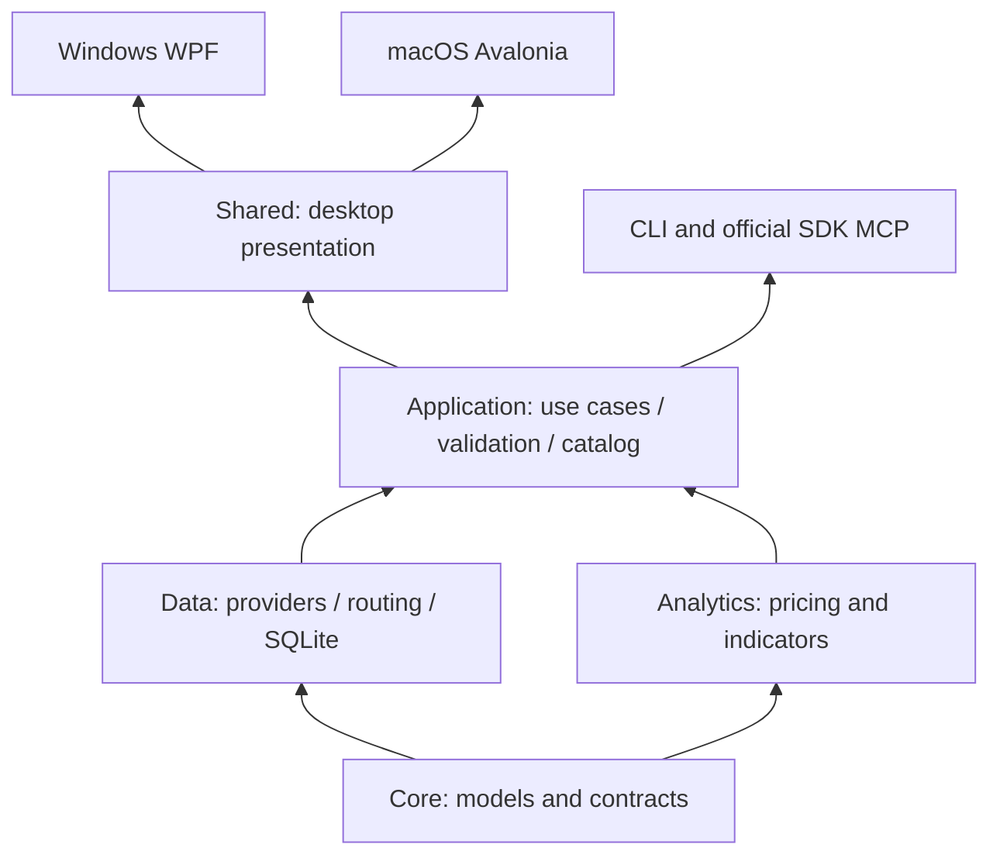

# EasySellPut 0.6：本地桌面工作台、CLI/MCP、统一设计系统与跨平台交付

## 1. 合并目的与对比基线

本 PR 在保留本地数据和现有行情、期权、策略分析能力的基础上，增加共享应用层、CLI/MCP、原生 WebView 工作台，并统一桌面交互与 GitHub Actions 交付流程。**这是供上游评审的草稿，不执行合并或发布。**

| 项目 | 本次基线 |
| --- | --- |
| 目标仓库/分支 | `ytqciscocarl/EasySellPut:main` |
| 来源仓库/分支 | `two4i6/EasySellPut:work` |
| 上游基线 | `1227a79756ecd673279f888ae982692c6361f449`（0.5.3） |
| 已验证应用版本 | `27d261b959e6dbb973f8528a5c455af9a084adcb`（0.6.0） |
| 功能基线提交差异 | 上游独有 0；本分支独有 80 commits |
| 功能基线文件差异 | 405 文件，+97,907 / −1,832 行 |
| 行数解释 | 两份生成的 UX 组件清单占新增 75,059 行；不能将总新增行数理解为手写业务代码量 |

上述 80 commits/405 文件统计固定在原功能基线。后续新增更新提醒（e9d4c5a）与图表单行状态栏（045f680），以及 Full HD 截图/CI 兼容处理/评审文档，均单独提交并在第 8.4、8.5 节列出。最新上游重新拉取后仍为同一基线，没有遗漏待合并的上游提交。上游 0.5.3 的已有修复已包含，本文不会把它们算作本分支原创。

当前工作分支的应用功能 SHA 为 `045f680`；原功能基线和本次追加功能分开记录，完整当前差异清单见仓库同目录的 `current-diff-inventory.json`。该清单也包含截图材料，二进制 PNG 没有文本行数。

### 1.1 变化摘要

| 范围 | 原有基础 | 本分支增加或调整 |
| --- | --- | --- |
| 产品形态 | 本地桌面行情/期权工具 | 保留本地；增加 CLI、stdio MCP 和 companion skill |
| 业务调用 | 桌面编排为主 | Application 统一 45 项操作；桌面与自动化复用 |
| 图表 | 原有桌面绘图 | 系统 WebView + Lightweight Charts，多指标、事件、画线和策略工作台 |
| 导航与阅读 | 较宽菜单、新闻独立窗口 | 单列图标导航、自定义网页、左右分屏阅读 |
| UI 维护 | 页面内样式与说明较多 | 统一 tokens、原生/CSS 生成资源与复用组件、图标帮助 |
| 桌面常驻 | 主窗口为中心 | 托盘/菜单栏行情、真实 mini 走势图、后台运行与工作量管理 |
| 自动化交付 | 原有构建基础 | 4 桌面/5 CLI 目标、真实原生包执行、main-only 签名发布链 |

### 1.2 完整审查附件

- [当前工作分支完整文件差异](https://github.com/two4i6/EasySellPut/blob/d6d3b0ba3cfdaea32d7d59589bf581575c872d0f/docs/pr-review/current-diff-inventory.json)（固定 045f680，478 文件；含评审截图与清单）

- [405 个功能基线变更文件：新增/删除行数及重命名来源](https://github.com/two4i6/EasySellPut/blob/d6d3b0ba3cfdaea32d7d59589bf581575c872d0f/docs/pr-review/diff-inventory.json)
- [80 个功能提交完整清单](https://github.com/two4i6/EasySellPut/blob/d6d3b0ba3cfdaea32d7d59589bf581575c872d0f/docs/pr-review/feature-commits.txt)
- [45 项操作完整名称、描述、参数 JSON Schema 与写入标记](https://github.com/two4i6/EasySellPut/blob/d6d3b0ba3cfdaea32d7d59589bf581575c872d0f/docs/pr-review/operation-catalog.json)
- [Full HD 与弹窗图片尺寸、渲染环境、测试数据标记及 SHA-256](https://github.com/two4i6/EasySellPut/blob/d6d3b0ba3cfdaea32d7d59589bf581575c872d0f/docs/pr-review/screenshots.json)
- [四架构安装文件、字节数、SHA-256 和 CI 下载地址](https://github.com/two4i6/EasySellPut/blob/d6d3b0ba3cfdaea32d7d59589bf581575c872d0f/docs/pr-review/installers.json)

## 2. 截图说明：全部按 Full HD 查看

本 PR 的主截图均为 **1920×1080、device scale 1、100% 缩放的真实重新渲染**，没有把小图放大。GitHub 正文会随容器缩小，点击图片或“原图”可查看完整桌面尺寸。52 张 Full HD 原图及 2 张自然尺寸弹窗原图均保存到仓库，便于长期审查。

- **原生控件截图**：Avalonia Headless/Skia 实际应用控件和布局；不含操作系统标题栏，不能作为 macOS/Windows 系统集成已通过的单独证明。
- **Web 工作台截图**：Chromium 执行实际内置页面，通过私有 C# 测试宿主获得数据和计算结果；不是静态设计稿，也不代表发布包捆绑 Chromium。
- **数据均为测试夹具**：图中行情、新闻、未来到期日、MCP 会话和 0.7.0 更新状态用于复现，不代表真实市场、真实 AI 客户端连接或公开版本。真实网络验证与原生平台验证在第 10 节分别列出。
- Headless 中不能创建系统 WebView 的图表/策略页面，其原生布局图仅用于布局审查；实际图表以浏览器工作台截图为准。

## 3. 共享应用层、CLI 与 MCP

### 3.1 工程边界



- Application 不引用 Shared、桌面、CLI 或 WebView；命令行不用启动 GUI。保留部分 `Meili.Shared.Services` 兼容命名空间，它们所属程序集已下移，并不形成反向依赖。
- `Meili.Analytics` 的算法源码相对本次上游基线没有变化。已有定价、Greeks、技术指标被新的入口复用，不能把算法本身描述为全部重写。
- `OperationCatalog` 是操作名称、参数约束和权限的统一来源。CLI 和 MCP 处理传输与格式，不各写一套金融业务逻辑。
- 保留来源、市场时间、下载时间、声明延迟、调整口径、离线缓存和缺失含义；非有限数字编码为 null 并携带计算状态，不填造行情。

### 3.2 45 项业务操作及默认只读

**27 项读取 + 18 项写入**。MCP 默认只暴露读取工具；启用 `--allow-writes` 后才发现并执行写工具，直接猜测工具名也无法绕过权限。所有操作均有真实 CLI/MCP 进程一致性案例，不以“工具数等于 45”代替能力测试。

| 操作 | 权限 | 语义 |
| --- | --- | --- |
| `search_symbols` | 读取 | Search symbols across configured providers. |
| `get_quotes` | 读取 | Batch quotes with source, market time, download time and declared delay. Missing symbols are reported. |
| `get_bars` | 读取 | Historical OHLCV with provenance, adjustment and offline-cache status. Missing OHLC is null, never fabricated. |
| `get_expirations` | 读取 | List option expiration dates. |
| `get_option_chain` | 读取 | Paginated option contracts with source metadata and non-executable midpoint/last entry references (missing quotes stay null). Request expiry YYYY-MM-DD and optional right/strike filters. |
| `get_fundamentals` | 读取 | Company fundamentals with source and freshness metadata. |
| `get_financials` | 读取 | Financial statements with source and freshness metadata. |
| `get_news` | 读取 | Recent provider news, retaining publisher, URL and publication time. |
| `get_market_events` | 读取 | Recent news and current earnings/ex-dividend calendar snapshot, with source, exact/date-only timing and estimate/confirmation metadata. Not a historical corporate-action archive. |
| `get_source_health` | 读取 | Source health observed in THIS process only; unknown is not a successful connectivity check. |
| `calculate_option` | 读取 | European Black-Scholes price/Greeks and optional solved IV; decimal units (0.25=25%). No network. |
| `calculate_indicators` | 读取 | SMA, EMA and RSI on supplied close prices. Warm-up values are null. No network. |
| `analyze_strategy` | 读取 | Position expiry P/L, boundedness, breakevens, optional pre-expiry Greeks and Reg-T estimate. Mixed expiries require valuationTime and IV. No network. |
| `get_watchlists` | 读取 | Read grouped watchlists from the local desktop data directory. |
| `create_watchlist_group` | 写入 | Create a local watchlist group. |
| `rename_watchlist_group` | 写入 | Rename a local watchlist group. |
| `delete_watchlist_group` | 写入 | Remove a group; its symbols move to the first remaining group. The last group cannot be deleted. |
| `add_watchlist_symbol` | 写入 | Add a ticker to a group. |
| `remove_watchlist_symbol` | 写入 | Remove a ticker from a group. |
| `get_saved_strategies` | 读取 | Read saved local strategies. |
| `save_strategy` | 写入 | Save/replace a local strategy by name, using desktop-compatible JSON. |
| `delete_strategy` | 写入 | Delete a saved strategy by name. |
| `get_alerts` | 读取 | Read local alert rules. Desktop remains responsible for continuous monitoring. |
| `get_alert_history` | 读取 | Read paginated local alert history. |
| `save_alert` | 写入 | Create a rule, or update an existing id while retaining monitor bookkeeping. Does not start monitoring. |
| `delete_alert` | 写入 | Delete an alert rule; history is retained. |
| `set_alert_enabled` | 写入 | Enable/disable and re-arm a local alert rule. |
| `probe_data_sources` | 读取 | Actively probe configured provider identities using the desktop router. Results apply to this process and the probed endpoint only; not a test of every capability. No arbitrary URLs. |
| `clear_alert_history` | 写入 | Clear local alert history, retaining alert rules and monitor state. Explicit write. |
| `move_watchlist_symbol` | 写入 | Reorder one symbol within a watchlist group; target index is zero-based. Conflict-safe local write. |
| `get_chart_analysis` | 读取 | All desktop K-line indicators (MA/EMA/BOLL/MACD/RSI/KDJ) and real volume on provider bars, computed before pagination; incomplete OHLC remains null. Optional comparison is rebased only on common timestamps. |
| `analyze_option_chain` | 读取 | Desktop option enrichment, IV smile, Greeks, spread/distance and previous local OI. Missing spot/quotes stay missing. Uses configured pricing assumptions; optional valuationTime makes time deterministic. |
| `get_pricing_assumptions` | 读取 | Configured/fetched risk-free rate with origin and symbol dividend yield. Unavailable yield falls back to zero explicitly. |
| `get_volatility_insights` | 读取 | Current IV, IV rank/percentile from existing local history, and up to eight ATM term expirations. Does not record new history; insufficient history is explicit. |
| `record_option_snapshot` | 写入 | Record current IV and OI into the shared local SQLite history. Explicit write; no background monitoring. Does not invent past observations. |
| `list_strategy_presets` | 读取 | Discover every supported strategy preset and its near/far expiry requirements. Custom legs use analyze_strategy/save_strategy. |
| `build_strategy` | 读取 | Build any desktop preset from caller-supplied listed reference quotes using the shared Analytics strike selection. No network/save; reference premiums are not executable quotes. |
| `strategy_what_if` | 读取 | Position and per-leg values/P&L/facts at an assumed price, with optional future horizon and IV shift. No GUI state/save. Mixed expiry requires valuationTime. |
| `get_chart_drawings` | 读取 | Read a symbol's persisted local horizontal/trend lines; does not control chart windows. |
| `add_chart_drawing` | 写入 | Persist a bounded horizontal/trend line in the shared drawing store with conflict protection. Trend lines need distinct time1/time2. |
| `update_chart_drawing` | 写入 | Replace one persisted drawing by absolute zero-based index (offset + row index) using the revision from get_chart_drawings. Stale revisions fail without overwriting. |
| `delete_chart_drawing` | 写入 | Delete one persisted drawing by absolute zero-based index (offset + row index) using the revision from get_chart_drawings. Other drawings remain; stale revisions fail. |
| `clear_chart_drawings` | 写入 | Clear persisted drawings for one symbol with conflict protection. |
| `update_preferences` | 写入 | Patch allowlisted local preferences; omitted fields remain unchanged. No proxy URL/credentials, arbitrary paths or window control. Desktop reload/restart required after external changes. |
| `get_settings` | 读取 | Read non-secret preferences and resolved data directory; proxy credentials/URLs are omitted. |

### 3.3 使用方式与协议约束

```sh
easysellput quote AAPL MSFT --json
easysellput search apple --limit 10 --json
easysellput bars AAPL --interval 1d --limit 100 --json
easysellput get_quotes --symbols '["AAPL","MSFT"]' --json
easysellput mcp serve --data-dir "/path/to/local/data"
# 仅在确实需要修改本地状态时显式启用：
easysellput mcp serve --data-dir "/path/to/local/data" --allow-writes
```

- CLI 支持人类可读与 JSON 输出，稳定结果封装、错误和退出码；stdout 单个 JSON 结果，诊断走 stderr。
- MCP 使用官方 SDK 的 stdio transport，stdout 仅协议数据，覆盖发现、参数错误、取消、超时、退出与清理。
- 不提供任意 shell、任意文件读取、任意浏览器执行、凭证读取或自安装 MCP 工具。
- 两种入口均使用同一 `--data-dir`、分页与参数边界。CLI 的连接安装维护命令不是额外的业务 MCP 工具；OS 窗口控制、后台监控与界面动作也有明确 ownership 边界。

### 3.4 本地数据与多进程安全

- 统一普通/portable 数据目录；JSON 使用 `SnapshotFile` 跨进程锁、原子替换和 revision 乐观冲突检测。遇到旧版本或损坏数据不静默覆盖。
- 长驻 MCP 每次操作重新读取存储，避免只持有启动时快照。图形界面和自动化并行写入有明确冲突反馈。
- SQLite 继续承担本地缓存与观察数据；保留迁移、锁竞争和并发验证。
- IV/OI 记录属于显式写操作；读取分析只使用已有样本，不伪造历史。偏好补丁采用 allowlist，保留未传字段，不返回代理凭证。

### 3.5 Codex / Claude Code / 通用 harness 接入

新增统一 `McpConnectionSetup`、嵌入式 companion skill 和带预检的 CLI 接入流程：识别路径/数据目录、只读授权、已有配置冲突、手改 skill 保护和 scoped replacement。Skill 覆盖全部 45 项操作，并说明查询顺序、来源/时间、缺失值、写入前置条件及冲突恢复。

桌面只复制统一配置 prompt，不直接执行粘贴命令。提示适用于不同 harness；专用接入命令提供客户端配置便利。底部 MCP 状态基于当前数据目录的已初始化、仍存活会话；“复制了配置”不会显示成“已经连接”。

**AI 接入：统一配置、命令与 companion skill** · [1920×1080 原图](https://raw.githubusercontent.com/two4i6/EasySellPut/d6d3b0ba3cfdaea32d7d59589bf581575c872d0f/docs/pr-review/screenshots/ai-setup.png)

[](https://raw.githubusercontent.com/two4i6/EasySellPut/d6d3b0ba3cfdaea32d7d59589bf581575c872d0f/docs/pr-review/screenshots/ai-setup.png)

**MCP 状态：测试会话详情，非真实 Codex 连接** · [1920×1080 原图](https://raw.githubusercontent.com/two4i6/EasySellPut/d6d3b0ba3cfdaea32d7d59589bf581575c872d0f/docs/pr-review/screenshots/ai-session-status.png)

[](https://raw.githubusercontent.com/two4i6/EasySellPut/d6d3b0ba3cfdaea32d7d59589bf581575c872d0f/docs/pr-review/screenshots/ai-session-status.png)

## 4. 内置图表、事件与策略工作台

### 4.1 Lightweight Charts 与指标

- 将 K 线绘制迁移到系统 WebView 中的 **Lightweight Charts 5.3.0**，随包离线资源，保留 Apache-2.0、NOTICE 与图表归属；不是 Advanced Charts，也不提供 Pine Script。
- MA / EMA / BOLL / 成交量 / MACD / RSI / KDJ 的数值继续在 C# Analytics 计算。前端负责绘制与交互，不复制算法。
- 支持缩放、平移、十字光标 OHLC、指标参数、对比标的、适应窗口、调整口径、来源与数据范围提示。缺失点保留断点，不插造数据。
- 盘前/盘后使用独立背景色并提供图例；基于 Eastern 时区和 MarketClock，不宣称覆盖交易所完整节假日/提前收盘日历。

**图表：浅色、多 pane 指标与盘前盘后背景** · [1920×1080 原图](https://raw.githubusercontent.com/two4i6/EasySellPut/d6d3b0ba3cfdaea32d7d59589bf581575c872d0f/docs/pr-review/screenshots/sessions-light.png)

[](https://raw.githubusercontent.com/two4i6/EasySellPut/d6d3b0ba3cfdaea32d7d59589bf581575c872d0f/docs/pr-review/screenshots/sessions-light.png)

**图表：深色及相同指标布局** · [1920×1080 原图](https://raw.githubusercontent.com/two4i6/EasySellPut/d6d3b0ba3cfdaea32d7d59589bf581575c872d0f/docs/pr-review/screenshots/sessions-dark.png)

[](https://raw.githubusercontent.com/two4i6/EasySellPut/d6d3b0ba3cfdaea32d7d59589bf581575c872d0f/docs/pr-review/screenshots/sessions-dark.png)

### 4.2 画线交互与持久化

水平线/趋势线只响应价格 pane；支持首点、实时预览、Esc 取消，完成后回到平移。支持选择、编辑和删除单条，清除全部仍为独立动作。使用工具/chart epoch、绝对索引和 revision 校验，防止换标的后的旧手势误写、分页删除错位或外部修改被覆盖；CLI/MCP 复用同一存储语义。

**趋势线：第二点实时预览** · [1920×1080 原图](https://raw.githubusercontent.com/two4i6/EasySellPut/d6d3b0ba3cfdaea32d7d59589bf581575c872d0f/docs/pr-review/screenshots/drawing-trend-preview-dark.png)

[](https://raw.githubusercontent.com/two4i6/EasySellPut/d6d3b0ba3cfdaea32d7d59589bf581575c872d0f/docs/pr-review/screenshots/drawing-trend-preview-dark.png)

**选中画线：编辑、删除与状态反馈** · [1920×1080 原图](https://raw.githubusercontent.com/two4i6/EasySellPut/d6d3b0ba3cfdaea32d7d59589bf581575c872d0f/docs/pr-review/screenshots/drawing-selected-light.png)

[](https://raw.githubusercontent.com/two4i6/EasySellPut/d6d3b0ba3cfdaea32d7d59589bf581575c872d0f/docs/pr-review/screenshots/drawing-selected-light.png)

### 4.3 新闻、财报、除息与完整聚合选择

`MarketTimelineService` 统一事件快照，保留原始 Eastern 发布时间、只有日期/区间/未知时间、预计/已确认状态和来源。图表对齐时间与原始事件时间分开保存；范围外不硬塞到最近一根 K 线，也不将当前快照冒充长期历史归档。

右侧动态栏常驻，新闻/财报/除息筛选、日期分组和历史导航采用同一数据集合。**tooltip 的聚合数量与点击后的全部事件使用同一过滤后的 candle bucket**；例如 marker 为 28 时，右侧展示该 bucket 的 28 条，不再只打开第一条详情。保留返回全部、滚动、逐条查看和未知时间分组。

**事件聚合 tooltip：数量与原始事件时间** · [1920×1080 原图](https://raw.githubusercontent.com/two4i6/EasySellPut/d6d3b0ba3cfdaea32d7d59589bf581575c872d0f/docs/pr-review/screenshots/event-tooltip-grouped-dark.png)

[](https://raw.githubusercontent.com/two4i6/EasySellPut/d6d3b0ba3cfdaea32d7d59589bf581575c872d0f/docs/pr-review/screenshots/event-tooltip-grouped-dark.png)

**点击 28 条聚合事件：右侧完整集合，可滚动查看** · [1920×1080 原图](https://raw.githubusercontent.com/two4i6/EasySellPut/d6d3b0ba3cfdaea32d7d59589bf581575c872d0f/docs/pr-review/screenshots/event-group-28-dark.png)

[](https://raw.githubusercontent.com/two4i6/EasySellPut/d6d3b0ba3cfdaea32d7d59589bf581575c872d0f/docs/pr-review/screenshots/event-group-28-dark.png)

**新闻时间线与日期历史导航** · [1920×1080 原图](https://raw.githubusercontent.com/two4i6/EasySellPut/d6d3b0ba3cfdaea32d7d59589bf581575c872d0f/docs/pr-review/screenshots/news-history-light.png)

[](https://raw.githubusercontent.com/two4i6/EasySellPut/d6d3b0ba3cfdaea32d7d59589bf581575c872d0f/docs/pr-review/screenshots/news-history-light.png)

### 4.4 期权链与策略联动

- 链表保留买卖报价、价差、成交量、OI/变化、IV 和 Greeks；紧凑列/分析在复用 popover 中配置，教程说明改为上下文 icon + tooltip。
- 选择执行价后可按方向加入策略；链表、原生策略编辑与 Web 工作台共享同一个 StrategyViewModel。
- 内置多腿 payoff、Greeks、到期/what-if 交互图；保留输入 premium、标的/草稿身份与数值来源。midpoint/last 是非可成交参考，报价缺失就显示缺失。
- 定价假设继续明确 BSM 欧式近似、利率/分红和模型限制；不含下单功能。原有详细 tab 和 IV 图部分继续使用原生/ScottPlot，并未声称全项目绘图均被替换。

**期权链：统一查询栏、行权价范围与双侧报价** · [1920×1080 原图](https://raw.githubusercontent.com/two4i6/EasySellPut/d6d3b0ba3cfdaea32d7d59589bf581575c872d0f/docs/pr-review/screenshots/page-options-light.png)

[](https://raw.githubusercontent.com/two4i6/EasySellPut/d6d3b0ba3cfdaea32d7d59589bf581575c872d0f/docs/pr-review/screenshots/page-options-light.png)

**期权分析与列设置：popover 替代整行帮助折叠条** · [1920×1080 原图](https://raw.githubusercontent.com/two4i6/EasySellPut/d6d3b0ba3cfdaea32d7d59589bf581575c872d0f/docs/pr-review/screenshots/options-columns.png)

[](https://raw.githubusercontent.com/two4i6/EasySellPut/d6d3b0ba3cfdaea32d7d59589bf581575c872d0f/docs/pr-review/screenshots/options-columns.png)

**策略工作台：合约、策略腿、盈亏和 Greeks，C# 测试计算** · [1920×1080 原图](https://raw.githubusercontent.com/two4i6/EasySellPut/d6d3b0ba3cfdaea32d7d59589bf581575c872d0f/docs/pr-review/screenshots/workbench-light.png)

[](https://raw.githubusercontent.com/two4i6/EasySellPut/d6d3b0ba3cfdaea32d7d59589bf581575c872d0f/docs/pr-review/screenshots/workbench-light.png)

**策略工作台：深色主题** · [1920×1080 原图](https://raw.githubusercontent.com/two4i6/EasySellPut/d6d3b0ba3cfdaea32d7d59589bf581575c872d0f/docs/pr-review/screenshots/workbench-dark.png)

[](https://raw.githubusercontent.com/two4i6/EasySellPut/d6d3b0ba3cfdaea32d7d59589bf581575c872d0f/docs/pr-review/screenshots/workbench-dark.png)

## 5. 阅读、导航与桌面操作

### 5.1 原生 WebView 与左右分屏新闻

Windows 使用 WebView2，macOS 使用 WKWebView，不随包附带 CEF/Chromium。点击新闻在现有页面内打开左右分屏，紧凑显示来源和刷新/外部打开/关闭；移除独立 modal、冗长地址栏和默认大段说明。拖动分隔线保留浏览器实例、历史和比例，关闭释放对应浏览器。

远程页面仅允许 HTTP/HTTPS，无私有图表 token/本地桥接、注入脚本、下载或权限授予；跳转与弹窗经过验证。私有图表使用独立、带 token 的 loopback 文档及有限类型事件；新闻 URL 根据当前 C# 事件身份解析，而不是信任网页传来的任意链接。

原生新闻分屏截图与 WebView/窗口生命周期证据保存在安装包 CI 的 native evidence artifact 中；此处完整页面图展示原生控件布局，不能冒充系统 WebView 已在 Headless 内加载。左右分屏原生测试独立列在验证表中。

**Windows 原生 WebView2 左右分屏：真实 1920×1080 桌面，CI 045f680，测试新闻** · [原图](https://raw.githubusercontent.com/two4i6/EasySellPut/d6d3b0ba3cfdaea32d7d59589bf581575c872d0f/docs/pr-review/screenshots/desktop-smoke-news-split-full-desktop.png)

[](https://raw.githubusercontent.com/two4i6/EasySellPut/d6d3b0ba3cfdaea32d7d59589bf581575c872d0f/docs/pr-review/screenshots/desktop-smoke-news-split-full-desktop.png)

### 5.2 Discord 风格单列导航与个人网页

主功能采用窄图标 rail，选中指示、hover/focus 反馈、可访问名称统一。设置/语言/主题/动效移至底部状态栏，避免和主导航重复。

继续保留 `+` 添加网页，以及编辑、排序、移除、切换和会话保持；网页按需创建，隐藏时不重复加载，重排不丢失实例。只持久化书签元数据，不将浏览历史或凭证混入共享 JSON 存储。

### 5.3 沉浸式窗口

顶栏与应用背景统一，不重复展示居中的应用名称；保留原生关闭/最小化/最大化或 macOS traffic lights 的安全区域，工具栏和拖拽区不覆盖系统按钮。继续支持拖动、最大化/全屏、恢复和不支持平台的 fallback。

Headless 截图不含系统按钮，因此跨平台窗口行为以原生 CI 测试与人工平台验收为准，不能根据无边框图片推断 OS 安全区已验证。

## 6. 九个页面逐页变化

### 6.1 概览

精简欢迎介绍，保留短的可关闭快速入口；行情卡统一来源/时间、价格/涨跌层次及图表跳转。统一刷新反馈和错误展示，不用大段说明承担导航。

**概览：浅色、快捷入口与行情卡** · [1920×1080 原图](https://raw.githubusercontent.com/two4i6/EasySellPut/d6d3b0ba3cfdaea32d7d59589bf581575c872d0f/docs/pr-review/screenshots/page-dashboard-light.png)

[](https://raw.githubusercontent.com/two4i6/EasySellPut/d6d3b0ba3cfdaea32d7d59589bf581575c872d0f/docs/pr-review/screenshots/page-dashboard-light.png)

**概览：深色，统一卡片与文字层次** · [1920×1080 原图](https://raw.githubusercontent.com/two4i6/EasySellPut/d6d3b0ba3cfdaea32d7d59589bf581575c872d0f/docs/pr-review/screenshots/page-dashboard-dark.png)

[](https://raw.githubusercontent.com/two4i6/EasySellPut/d6d3b0ba3cfdaea32d7d59589bf581575c872d0f/docs/pr-review/screenshots/page-dashboard-dark.png)

### 6.2 自选

分组切换、添加 symbol、移动/移除和价格展示统一组件；分组编辑保留草稿与校验，常用动作紧邻数据。自选持久化与 CLI/MCP 共用同一并发保护。

**自选：分组和行情列表** · [1920×1080 原图](https://raw.githubusercontent.com/two4i6/EasySellPut/d6d3b0ba3cfdaea32d7d59589bf581575c872d0f/docs/pr-review/screenshots/page-watchlist-light.png)

[](https://raw.githubusercontent.com/two4i6/EasySellPut/d6d3b0ba3cfdaea32d7d59589bf581575c872d0f/docs/pr-review/screenshots/page-watchlist-light.png)

**自选：分组编辑草稿** · [1920×1080 原图](https://raw.githubusercontent.com/two4i6/EasySellPut/d6d3b0ba3cfdaea32d7d59589bf581575c872d0f/docs/pr-review/screenshots/watchlist-group-draft.png)

[](https://raw.githubusercontent.com/two4i6/EasySellPut/d6d3b0ba3cfdaea32d7d59589bf581575c872d0f/docs/pr-review/screenshots/watchlist-group-draft.png)

### 6.3 K 线

顶部 symbol、周期、指标/刷新/导出保持同组高度，宽度允许时一行排列；画线工具、价格 pane、右侧动态和下方数据状态分工明确。实际图表及交互截图见第 4 节；下图仅为 Headless 原生外壳，不把留空的系统 WebView 区当成功加载证据。

原生图表布局外壳另存于截图清单，实际图表与分屏效果以第 4、5 节截图为准。

### 6.4 期权链

查询、到期日、行权价范围与选中合约操作集中；列设置、帮助和模型假设按需展开；保留延迟、来源、报价时间及 IV 样本覆盖。完整截图见第 4.4 节。

### 6.5 策略

模板/多腿编辑、参考权利金、关键风险、图表与明细采用统一组合；保留用户录入及草稿，避免异步行情覆盖 premium。下面展示原生编辑区域；实际交互图表见 Web 工作台截图。

**策略原生编辑布局：WebView 外壳不作为图表执行证据** · [1920×1080 原图](https://raw.githubusercontent.com/two4i6/EasySellPut/d6d3b0ba3cfdaea32d7d59589bf581575c872d0f/docs/pr-review/screenshots/page-strategy-light.png)

[](https://raw.githubusercontent.com/two4i6/EasySellPut/d6d3b0ba3cfdaea32d7d59589bf581575c872d0f/docs/pr-review/screenshots/page-strategy-light.png)

### 6.6 新闻与基本面

symbol 查询、刷新、来源、基本面字段和新闻列表统一层次；历史日期导航和事件详情以可访问图标、选中态、时间与来源辅助阅读。原文使用左右分屏，窗口中不再重复一层 modal。

**新闻与基本面：信息分区与来源** · [1920×1080 原图](https://raw.githubusercontent.com/two4i6/EasySellPut/d6d3b0ba3cfdaea32d7d59589bf581575c872d0f/docs/pr-review/screenshots/page-news-light.png)

[](https://raw.githubusercontent.com/two4i6/EasySellPut/d6d3b0ba3cfdaea32d7d59589bf581575c872d0f/docs/pr-review/screenshots/page-news-light.png)

**新闻与基本面：深色主题** · [1920×1080 原图](https://raw.githubusercontent.com/two4i6/EasySellPut/d6d3b0ba3cfdaea32d7d59589bf581575c872d0f/docs/pr-review/screenshots/page-news-dark.png)

[](https://raw.githubusercontent.com/two4i6/EasySellPut/d6d3b0ba3cfdaea32d7d59589bf581575c872d0f/docs/pr-review/screenshots/page-news-dark.png)

### 6.7 价格提醒

创建、编辑、启停和删除沿用同一操作风格；规则表单与高级参数分层，校验贴近输入，失败时保留已输入值。CLI/MCP 管理规则，持续监控仍归桌面拥有，不另起第二套后台定时器。

**价格提醒：规则与编辑入口** · [1920×1080 原图](https://raw.githubusercontent.com/two4i6/EasySellPut/d6d3b0ba3cfdaea32d7d59589bf581575c872d0f/docs/pr-review/screenshots/page-alerts-light.png)

[](https://raw.githubusercontent.com/two4i6/EasySellPut/d6d3b0ba3cfdaea32d7d59589bf581575c872d0f/docs/pr-review/screenshots/page-alerts-light.png)

**价格提醒：高级参数** · [1920×1080 原图](https://raw.githubusercontent.com/two4i6/EasySellPut/d6d3b0ba3cfdaea32d7d59589bf581575c872d0f/docs/pr-review/screenshots/alerts-advanced.png)

[](https://raw.githubusercontent.com/two4i6/EasySellPut/d6d3b0ba3cfdaea32d7d59589bf581575c872d0f/docs/pr-review/screenshots/alerts-advanced.png)

### 6.8 数据源

统一展示各源可用性、检查与重试状态，保留真实连通性及来源，不以演示数据冒充在线成功；保持取消与过期结果保护。

**数据源：状态、检测和错误反馈** · [1920×1080 原图](https://raw.githubusercontent.com/two4i6/EasySellPut/d6d3b0ba3cfdaea32d7d59589bf581575c872d0f/docs/pr-review/screenshots/page-datasources-light.png)

[](https://raw.githubusercontent.com/two4i6/EasySellPut/d6d3b0ba3cfdaea32d7d59589bf581575c872d0f/docs/pr-review/screenshots/page-datasources-light.png)

### 6.9 设置

统一 `AppFormHeader` 和行布局，标签垂直居中、help 和字段列对齐；语言、主题、涨跌配色、关闭行为、代理配置和当前生效状态采用同一表单体系。帮助使用可访问 tooltip，不保留全宽说明下拉。更新状态与操作共用更新组件。

**设置：对齐的标签、帮助图标、选择器和输入框** · [1920×1080 原图](https://raw.githubusercontent.com/two4i6/EasySellPut/d6d3b0ba3cfdaea32d7d59589bf581575c872d0f/docs/pr-review/screenshots/page-settings-light.png)

[](https://raw.githubusercontent.com/two4i6/EasySellPut/d6d3b0ba3cfdaea32d7d59589bf581575c872d0f/docs/pr-review/screenshots/page-settings-light.png)

**设置：深色主题与禁用态** · [1920×1080 原图](https://raw.githubusercontent.com/two4i6/EasySellPut/d6d3b0ba3cfdaea32d7d59589bf581575c872d0f/docs/pr-review/screenshots/page-settings-dark.png)

[](https://raw.githubusercontent.com/two4i6/EasySellPut/d6d3b0ba3cfdaea32d7d59589bf581575c872d0f/docs/pr-review/screenshots/page-settings-dark.png)

## 7. 可复用 UI 系统

### 7.1 视觉与资源单一来源

`src/Meili.Shared/DesignSystem/tokens.json` 管理 Claude-inspired 暖中性色、字体、间距、控件尺寸和动效，生成 WPF/Avalonia/CSS 资源。这里是受设计语言启发的统一实现，不是声称复用了 Claude 私有组件或源码。

字体为随包 Source Sans 3 / Source Serif 4 / Source Code Pro，保留 OFL；图标统一 **Lucide 1.73.0** 固定矢量资源，保留 ISC 和对应 Feather 子集 MIT 通知。采用可追溯固定版本，不在运行时拉取“latest”。图标画布、stroke、容器尺寸与居中规则统一，避免不同 font glyph 基线。

### 7.2 复用组件与状态

| 组件 | 用途和约束 |
| --- | --- |
| AppCard | 统一卡片背景、圆角、边框、内边距 |
| Button / Input styles | 同系列尺寸、图标画布、focus/disabled/pressed 状态 |
| AppSelect | 原生平台选择体验、主题一致及键盘访问 |
| AppFormHeader | 标签/help/字段列与垂直对齐 |
| AppHelp | icon + 可访问 tooltip；仅说明，不塞交互控件 |
| AppPopover | 列设置、分析参数等可交互次级操作 |
| AppDisclosure | 有意义的内容分层，不滥用整行“帮助”折叠条 |
| AppDrawer / AppDialog | 统一遮罩、焦点、关闭与返回行为 |
| AppLoading | 可识别的工作中状态与取消/失败衔接 |
| ArticleSplitView | 左右阅读容器，保留实例与浏览历史 |
| DesignMotion | 短、可打断、尊重 reduced motion 的 chrome 反馈 |

中英文、明暗、紧凑/宽屏、focus/disabled/selected/error 均为复用层验收维度。仅对小范围 UI chrome 添加过渡，不动画行情数字、整个页面、原生 WebView 或分隔尺寸，也不为了动画延迟取消。

**复用组件库：英文浅色与状态样例** · [1920×1080 原图](https://raw.githubusercontent.com/two4i6/EasySellPut/d6d3b0ba3cfdaea32d7d59589bf581575c872d0f/docs/pr-review/screenshots/mac-components-en-US-False.png)

[](https://raw.githubusercontent.com/two4i6/EasySellPut/d6d3b0ba3cfdaea32d7d59589bf581575c872d0f/docs/pr-review/screenshots/mac-components-en-US-False.png)

**复用组件库：中文深色与状态样例** · [1920×1080 原图](https://raw.githubusercontent.com/two4i6/EasySellPut/d6d3b0ba3cfdaea32d7d59589bf581575c872d0f/docs/pr-review/screenshots/mac-components-zh-CN-True.png)

[](https://raw.githubusercontent.com/two4i6/EasySellPut/d6d3b0ba3cfdaea32d7d59589bf581575c872d0f/docs/pr-review/screenshots/mac-components-zh-CN-True.png)

**复用 Select 的实际打开状态** · [1920×1080 原图](https://raw.githubusercontent.com/two4i6/EasySellPut/d6d3b0ba3cfdaea32d7d59589bf581575c872d0f/docs/pr-review/screenshots/mac-components-select-en-US-False.png)

[](https://raw.githubusercontent.com/two4i6/EasySellPut/d6d3b0ba3cfdaea32d7d59589bf581575c872d0f/docs/pr-review/screenshots/mac-components-select-en-US-False.png)

## 8. 常驻行情、后台运行与更新

### 8.1 macOS 菜单栏与 Windows 行情速览

macOS NSStatusItem 与 Windows 托盘/可固定行情面板提供逐 symbol 报价、涨跌、真实最新交易日 mini 走势图，以及打开图表、刷新、恢复窗口等入口。Windows 使用应用自己的面板，不向 Explorer 注入任务栏扩展。

迷你图只请求可见 symbol，限制并发、支持取消和代际过期结果拒绝；固定 Eastern 时轴、保留断点。报价与 bars 分别显示来源/时间，regular 和 extended price 不混为同一值。缺少 bars 时展示缺失，而不是根据最后价格编造曲线。原生 AppKit/Windows 截图与生命周期 JSON 在 CI evidence 中保留；小尺寸系统菜单证据不伪装成 1080p 全屏图。

### 8.2 后台运行与性能管理

关闭主窗口可选择询问、后台运行或退出，支持启动隐藏、恢复原页面与显式退出。复用 QuoteHub/QuotePump 和 DesktopActivity：无订阅不启动行情 timer；被动后台行情放缓至 30 秒；已启用的主动提醒维持配置频率，IV 取样仅在启用相关规则时运行。

隐藏/最小化暂停 UI 时钟、MCP 状态扫描等 chrome 工作并释放私有图表；恢复保留页面与 view model。个人网页会话保留，远程 native suspension 为尽力而为，不宣称所有网站都能零 CPU 后台运行。本次没有提供量化能耗、FPS 或硬件基准，不把减少定时器描述为已测得的固定性能提升。

**后台恢复：保留已有页面和自选状态的测试场景** · [1920×1080 原图](https://raw.githubusercontent.com/two4i6/EasySellPut/d6d3b0ba3cfdaea32d7d59589bf581575c872d0f/docs/pr-review/screenshots/background-restored.png)

[](https://raw.githubusercontent.com/two4i6/EasySellPut/d6d3b0ba3cfdaea32d7d59589bf581575c872d0f/docs/pr-review/screenshots/background-restored.png)

### 8.3 检查更新与安装

支持检查更新、版本信息、下载、校验、就绪与安装状态。更新仅接受固定官方仓库、受信任签名索引、精确版本/RID/大小/SHA-256 和有限 HTTPS 下载；拒绝降级、不兼容包、危险 archive 和信任覆盖。

安装 helper 位于安装树外，预检后等待精确父进程退出，执行同卷替换/失败回滚并保留用户数据；运行中的安装实例/MCP 可能阻止不安全替换。没有 MCP 安装器或任意 feed override。

**更新源现已自动绑定构建仓库：上游 Actions 构建读取上游，fork 构建读取 fork；本地构建默认禁用更新。正式发布前仍需维护者首次配置自己的签名公钥/私钥与发布环境。**

以下 0.7.0 是测试更新服务的夹具，只展示状态，不存在对应公开 Release。

**更新：发现版本的测试状态** · [1920×1080 原图](https://raw.githubusercontent.com/two4i6/EasySellPut/d6d3b0ba3cfdaea32d7d59589bf581575c872d0f/docs/pr-review/screenshots/update-available.png)

[](https://raw.githubusercontent.com/two4i6/EasySellPut/d6d3b0ba3cfdaea32d7d59589bf581575c872d0f/docs/pr-review/screenshots/update-available.png)

**更新：下载校验就绪的测试状态** · [1920×1080 原图](https://raw.githubusercontent.com/two4i6/EasySellPut/d6d3b0ba3cfdaea32d7d59589bf581575c872d0f/docs/pr-review/screenshots/update-ready.png)

[](https://raw.githubusercontent.com/two4i6/EasySellPut/d6d3b0ba3cfdaea32d7d59589bf581575c872d0f/docs/pr-review/screenshots/update-ready.png)

**更新：校验失败与可恢复错误状态** · [1920×1080 原图](https://raw.githubusercontent.com/two4i6/EasySellPut/d6d3b0ba3cfdaea32d7d59589bf581575c872d0f/docs/pr-review/screenshots/update-rejected.png)

[](https://raw.githubusercontent.com/two4i6/EasySellPut/d6d3b0ba3cfdaea32d7d59589bf581575c872d0f/docs/pr-review/screenshots/update-rejected.png)

### 8.4 本次追加：更新弹窗与按需显示的底部版本提示

在前述已验证应用基线之后，新增功能提交 `e9d4c5a`。提取 singleton `UpdateViewModel`，设置页、底部入口和两平台 `AppDialog` 共享下载/安装状态；不重复请求或绕过签名更新链。

- 正式启动后，在窗口可见时延迟 10 秒检查一次；无后台轮询，隐藏时取消启动检查。
- 同一版本每次启动只自动弹出一次；弹窗是应用拥有的非阻塞窗口，可选“稍后”。
- **没有新版本时底部没有更新入口**；发现版本后才显示 `v… 可更新`，点击可重新打开；下载完变为“待安装”。
- 检查/提醒不自动下载或安装；签名失败不显示新版本提示，仍保留已有手动检查和安装确认。
- 作为桌面 presentation-only 能力记录在 inventory；现在为 19 个 view-model 文件、84 个 RelayCommands，业务 MCP 目录仍是 45 项。
- 本地共享层 82 项、完整 Avalonia UI 回归 100 项、Python 守卫 53 项通过，Windows 编译通过；更新提醒 CI [43753616162](https://github.com/two4i6/EasySellPut/actions/runs/43753616162) 的 12 个任务全部通过；最新单行状态栏的 [43754610782](https://github.com/two4i6/EasySellPut/actions/runs/43754610782) 也已完成，全部 12 个任务通过。

**更新入口：仅在有可用版本时显示；1920×1080 测试界面** · [原图](https://raw.githubusercontent.com/two4i6/EasySellPut/d6d3b0ba3cfdaea32d7d59589bf581575c872d0f/docs/pr-review/screenshots/mac-update-notification-footer-zh-CN-False.png)

[](https://raw.githubusercontent.com/two4i6/EasySellPut/d6d3b0ba3cfdaea32d7d59589bf581575c872d0f/docs/pr-review/screenshots/mac-update-notification-footer-zh-CN-False.png)
**更新入口：英文深色；1920×1080 测试界面** · [原图](https://raw.githubusercontent.com/two4i6/EasySellPut/d6d3b0ba3cfdaea32d7d59589bf581575c872d0f/docs/pr-review/screenshots/mac-update-notification-footer-en-US-True.png)

[](https://raw.githubusercontent.com/two4i6/EasySellPut/d6d3b0ba3cfdaea32d7d59589bf581575c872d0f/docs/pr-review/screenshots/mac-update-notification-footer-en-US-True.png)

**Windows 原生更新提醒：真实 Full HD 桌面，测试版本** · [1920×1080 原图](https://raw.githubusercontent.com/two4i6/EasySellPut/d6d3b0ba3cfdaea32d7d59589bf581575c872d0f/docs/pr-review/screenshots/update-notification-full-desktop-zh-CN-False.png)

[](https://raw.githubusercontent.com/two4i6/EasySellPut/d6d3b0ba3cfdaea32d7d59589bf581575c872d0f/docs/pr-review/screenshots/update-notification-full-desktop-zh-CN-False.png)

下图保留弹窗自然尺寸（520 像素宽），不放大成假全屏；图中 v0.7.0 为夹具，不是公开 Release。

**更新提醒：自然尺寸详情、稍后与显式下载** · [原图](https://raw.githubusercontent.com/two4i6/EasySellPut/d6d3b0ba3cfdaea32d7d59589bf581575c872d0f/docs/pr-review/screenshots/mac-update-notification-dialog-zh-CN-False.png)

[](https://raw.githubusercontent.com/two4i6/EasySellPut/d6d3b0ba3cfdaea32d7d59589bf581575c872d0f/docs/pr-review/screenshots/mac-update-notification-dialog-zh-CN-False.png)

### 8.5 本次追加：单行图表状态栏

移除 WebView 中独立占一整行的“操作 / TradingView”页脚，保留一个原生状态栏：`AppHelp` 图标、loading、来源、复权与十字光标数据垂直对齐。正常状态不换行；长值省略显示，tooltip 保留完整文本。有实质意义的复权警告仍显式展示。

TradingView 不再作为常驻文字行显示。图表 header 的紧凑 Lucide Info 链接保留归属 tooltip、版权与外部跳转，图表自带 attribution logo 和包内 LICENSE/NOTICE 保留。真实浏览器测试覆盖无重复 footer、无常驻品牌文字、可聚焦/点击的链接与窄屏边界；两平台 UI 测试覆盖 980/1920 宽度、文字对齐与帮助打开。

### 8.6 后续追加：合并市场时段和数据源状态

原先左侧“休市”和右侧“数据源 0/8 正常”合并为单个 `休市 · 0/8` 入口。比例与圆点表示数据源健康情况，市场时段仍明确显示；完整说明与网络信息收进复用 `AppHelp` 的 hover/focus tooltip 和点击弹层。未知状态不冒充正常，degraded/down 使用警告色；隐藏时仍停止状态时钟，无新增轮询或 MCP 操作。对应共享状态及 WPF/Avalonia 明暗、中英文、窄屏/Full HD 测试已加入现有全量 CI 自动发现范围。后续修正统一了状态栏高度、行高和文字/圆点/图标的垂直中心；设置页“关于”数据来源与使用说明恢复为常显文本。

[最新 1080p 原图与实现说明](https://github.com/two4i6/EasySellPut/blob/work/docs/status-bar/README.md)。本节变更晚于前述 045f680 安装包；该旧包不包含这次底栏合并，新包以本节对应 work CI 为准。

### 8.7 后续追加：自动绑定更新仓库

CI 使用当前 `GITHUB_REPOSITORY` 编译更新源，不再固定 fork URL；运行时不能被环境变量、remote 或设置覆盖。本地默认禁用检查。新增只读维护命令 `update source --json`，用于离线审查内置源和公钥指纹；不增加 MCP 业务操作。签名索引增加仓库字段，客户端/安装助手同一规则拒绝跨仓库更新。真实上游/fork/local 构建场景、非法覆盖、错源/错公钥检查进入 CI；原生 GUI/CLI 包及签名后的包均验证编译绑定。main-only 发行政策和首次密钥配置要求不变。

此追加晚于前文 045f680 安装包；旧包继续绑定旧源，新行为以本次源码及新 CI 产物为准。[详细规则](https://github.com/two4i6/EasySellPut/blob/work/docs/29-检查更新与安装.md)。

## 9. CI、打包、签名与发布政策

### 9.1 Actions 覆盖

| 层 | 执行内容 |
| --- | --- |
| UI · Layout & Charts | 组件/布局、离线回归、真实 Chromium 交互和生成资源检查 |
| Windows x64 / ARM64 · Desktop | 完整离线 WPF suite、实际 WebView2、包结构/架构、解压带空格路径执行、更新替换与重启 |
| Mac Apple Silicon / Intel · Desktop | 原生 WKWebView、窗口/状态栏生命周期、实际包执行与更新检查 |
| 五平台 CLI/MCP | Linux x64、Win x64/ARM64、Mac Intel/Apple Silicon 原生真实进程验证 |
| Release · main guard | main-only 发布政策、来源与工作流边界 |
| CI · Required checks | 汇聚全部相关任务，作为分支保护 required check |

9 个目标产物 = 4 桌面 + 5 CLI。包内携带 automation CLI/MCP 和 skill。校验 runtime、PE/Mach-O 架构、哈希与包内容；不是交叉编译成功就宣称原生执行成功。

工作流命名统一为 `CI · Test & Package`、`Release · Prepare draft`、`Release · Publish`，job 名平台优先。旧 required check 重命名后，上游分支保护规则也要迁移至 `CI · Required checks`。

### 9.2 只有 main 可以 Release

```text
main push CI success
  → 验证确切 main SHA 和来源 CI
  → 复用该 CI 的九个产物（不重新编译应用）
  → Windows 正式签名 / macOS Developer ID + notarization
  → 最终签名包原生执行检查
  → 签名更新索引及产物来源证明
  → 自动准备 draft
  → 人工明确触发 Publish
```

`work` 和 PR 构建不发布。证书、notary 与签名私钥放在 main-only `release` Environment。不得本地发布 unsigned Release，也不把 ad-hoc 视作正式分发签名。

**现状：main 应用 CI 已通过，但正式签名配置未完成。自动 prepare run `43748436167` 的 main/CI 来源检查通过；Windows/macOS 签名任务因缺少凭证失败，draft 被跳过，本次流程没有发布新的公开 Release 或 tag。macOS 日志明确缺少 `APPLE_SIGNING_IDENTITY`。** 上游维护者需完成 Environment、证书、更新密钥和批准规则后再发布；这不影响下面审查用 CI 包的真实性，但不代表它们已通过公证。

### 9.3 Full HD 截图 CI 补充

本次评审追加了 Windows Actions 桌面 1920×1080 请求和实际全桌面原始像素证据。某些托管会话不能枚举显示模式，因此兼容处理改为读取实际桌面像素；不接受分辨率时保留真实尺寸并警告，不放大图片、不让截图准备误阻断后续功能测试。此补充不改变产品业务代码。

## 10. 验证结果与边界

### 10.1 已验证应用 SHA：27d261b

[main CI 43747828836：12 个任务成功](https://github.com/two4i6/EasySellPut/actions/runs/43747828836)

| 检查 | 结果/范围 |
| --- | --- |
| .NET 单元/回归项目 | Core 193、Data 129、Analytics 206、Shared 75、Mac 98、Automation 57、Windows 143；合计 901 项，不重复按架构累计 |
| Python 守卫 | 53 项，能力映射、UI/图标、设计资源、更新/发布/打包政策等 |
| Chromium | 15 项：renderer 6、workbench 3、timeline 4、sessions 1、drawings 1 |
| CLI/MCP parity | 45 项业务操作逐项、权限/参数/结果、实际双进程 transport |
| 平台包 | 4 个桌面架构、5 个 CLI 架构，实际原生执行及更新替换/重启 |
| 明确开启的真实网络验证 | 2026-11-15 17:20 UTC，CLI/MCP 各 8 类调用，共 16 通过、0 失败：quotes / bars / expirations / chain / fundamentals / financials / news / search |
| 本次 Full HD 捕获 | 原生应用 1 个捕获用例、组件图库 2 个用例、浏览器捕获复用 6 个交互用例通过；不将它们重复算入上面的主测试数 |

真实网络结果是该时点的外部服务证据，不能保证未来服务可用。所有图中的数值来自测试夹具，不能作为真实行情验证。

### 10.2 上游整合与连带回归

上游已有修复均包含；追加异步取消回归覆盖真实 SQLite 锁等待和暂停 UI continuation：过期 IV 加载不得污染新页面，离开页面/替换请求后旧期权表不能发布结果或错误清除新请求的 busy 状态。共用组件继续覆盖旧有页面，不另引一套视觉体系。

### 10.3 仍需上游/人工完成

- 上游首次配置正式更新公钥/私钥、平台签名/notary secrets、main-only Environment 与 required check 分支规则；更新源已由构建自动绑定，无需手改 URL。
- 正式签名/公证链尚未成功，下面包为未签名或 ad-hoc 的 CI 审查包；不能称为正式 trusted release。
- Linux 是已验证的 CLI x64 目标；Avalonia fallback 不代表新增正式 Linux GUI 安装包。
- 原生平台触摸板/多显示器/DPI、traffic lights/任务栏、长期后台能耗仍需在目标硬件人工验收；不根据 Headless 图片推断。
- 本 PR 截图和文档提交之后的 CI 状态，以对应 SHA 的最新 run 为准；不会把 pending 或失败 run 写成已通过。

### 10.4 最终工作分支功能验证：045f680

[CI 43754610782：全部 12 项成功](https://github.com/two4i6/EasySellPut/actions/runs/43754610782)，包括 `CI · Required checks`。后续提交仅更新评审文档、原图和安装文件清单，不再改动产品代码。PR head 的文档 CI 若仍在运行，不能与已通过的功能 SHA 混淆。

当前测试合计 914 项 .NET：Core 193、Data 129、Analytics 206、Shared 82、Mac 101、Automation 57、Windows 146；另有 53 项 Python 守卫、15 项 Chromium，45 项操作的真实 CLI/MCP 双进程 parity。Windows x64/ARM64 的 TRX 均记录 146 通过、0 失败，UI TRX 记录 101 通过、0 失败。所有四个桌面包及五个 CLI 包的原生执行/校验和更新重启任务均成功。

更新提醒、单行状态栏和重新生成的 1920×1080 原图均已纳入。所有 54 张图片（52 张 Full HD + 2 张自然尺寸弹窗）的 PNG 尺寸和 SHA-256 已重新逐一校验。基线后的完整提交清单见 [followup-commits.txt](https://github.com/two4i6/EasySellPut/blob/d6d3b0ba3cfdaea32d7d59589bf581575c872d0f/docs/pr-review/followup-commits.txt)。

## 11. 可安装的审查包

以下四个文件来自 **work CI 43754610782 / 功能 SHA 045f680 / 版本 0.6.0**，包含本 PR 全部功能，以及最新的更新提醒和单行图表状态栏。来源 run 的全部 12 个任务通过。main 旧基线包不再作为本节下载入口，避免安装到缺少新增提醒的版本。

**这是 CI 审查包，不是正式签名 Release。** Windows 为完整解压运行的 portable ZIP，macOS ZIP 内为 `.app`；不把大于 100 MB 的二进制塞进 Git，也不通过本地 Release 绕过 main-only 签名政策。GitHub artifact 下载可能需要登录。

| 平台 | 安装文件 | MiB | 下载 |
| --- | --- | ---: | --- |
| `osx-arm64` | `EasySellPut-Desktop-0.6.0-osx-arm64.zip` | 79.1 | [下载 artifact](https://github.com/two4i6/EasySellPut/actions/runs/43754610782/artifacts/14178175704) |
| `osx-x64` | `EasySellPut-Desktop-0.6.0-osx-x64.zip` | 83.9 | [下载 artifact](https://github.com/two4i6/EasySellPut/actions/runs/43754610782/artifacts/14177349917) |
| `win-x64` | `EasySellPut-Desktop-0.6.0-win-x64.zip` | 118.8 | [下载 artifact](https://github.com/two4i6/EasySellPut/actions/runs/43754610782/artifacts/14177863583) |
| `win-arm64` | `EasySellPut-Desktop-0.6.0-win-arm64.zip` | 111.9 | [下载 artifact](https://github.com/two4i6/EasySellPut/actions/runs/43754610782/artifacts/14177304882) |

### 11.1 SHA-256

```text
486c07f4b70e1cb26412b4b9e2d7658b32cd2dcf0c11ef433c9d83b09bd0ac55  EasySellPut-Desktop-0.6.0-osx-arm64.zip
73767fe0d803fcbd1bbe1bbda33f5c8e48271fc1c92a3f14ec2845e45826d2bd  EasySellPut-Desktop-0.6.0-win-x64.zip
4386c290d143833ceb47d90070b15ba11c78598d4e42b859b65ca83b4a064b71  EasySellPut-Desktop-0.6.0-osx-x64.zip
1c0f4a75026526479ca3d8b71e14aaccbf3e1d38959baddf40a4fc8f664980e1  EasySellPut-Desktop-0.6.0-win-arm64.zip
```

### 11.2 安装、来源与有效期

- Windows：完整解压文件夹，运行 `EasySellPut.exe`；保留随包 automation/resources。需要系统 Evergreen WebView2，不需安装 .NET SDK。
- macOS：选择 Apple Silicon 或 Intel ZIP，解压后将 `.app` 放入 Applications；审查包未完成正式 Developer ID 公证，按系统提示和组织策略处理，不关闭系统安全校验。
- 每个架构均已校验 GitHub artifact 外层摘要、ZIP CRC、内层安装 ZIP SHA-256 与 PE/Mach-O 目标架构。准确字节数、来源和到期时刻在安装清单中。
- artifact 保留 14 天，本批到期为 **2026-11-29 UTC**；过期需要从固定来源 SHA 重新运行 CI。永久稳定下载应由正常 main-only 签名发布流程提供，不把临时 artifact 冒充正式 Release。

## 12. 建议评审顺序与验收清单

### 12.1 评审顺序

1. 先看 Application 依赖边界、45 项 catalog、默认只读与 SnapshotFile 并发保护。
2. 再看 Shared view model 的取消/代际保护、桌面 lifecycle，以及图表/远程网页隔离。
3. 按 Full HD 图逐页核对复用组件、表单对齐和减少常驻说明文字。
4. 最后看包内 automation、native smoke、签名更新和 main-only 发布交接配置。

### 12.2 可重复人工验收

- [ ] 使用正确架构的完整解压包启动；图表/文章能加载，包内 CLI 不依赖本地 SDK。
- [ ] 自选添加、编辑分组、排序/移除，重启后数据保留；多进程冲突不会静默覆盖。
- [ ] K 线周期/指标/对比与缩放正常；盘前后底色、来源与时效符合数据。
- [ ] 水平/趋势线预览、Esc、完成回到平移，选中/编辑/删除单条与 CLI/MCP 修改一致。
- [ ] 点击多事件 marker，右侧数量和 tooltip 一致；历史导航、筛选与返回全部正确。
- [ ] 新闻在左右分屏打开，拖动不重建浏览器，关闭可恢复工作区；无重复 modal/地址栏。
- [ ] 自定义网页添加/编辑/排序/移除，切换保留会话；远程页面没有私有桥接权限。
- [ ] 链表选腿、策略 premium/草稿身份保持，盈亏/Greeks/what-if 使用同一计算结果。
- [ ] 中英文、明暗、字体、图标居中、键盘 focus、禁用态、表单错误和 reduced motion 正确。
- [ ] MCP 默认只读；复制配置不显示假连接；真实初始化会话才更新状态。
- [ ] 后台隐藏/恢复保留页面，主动提醒仍按设置运行，显式退出释放资源。
- [ ] 菜单栏/托盘报价和 mini 图来源/时间各自明确，缺失 bars 不生成假曲线。
- [ ] 更新错误可恢复，下载校验/父进程等待/回滚/数据保留符合规则；正式安装只使用上游正确签名源。

### 12.3 工程维护规则

精简英文 `AGENTS.md` 明确依赖层次、应用服务所有权、桌面/CLI/MCP 一致性、组件复用、截图交付、足够的回归测试和 CI 更新责任；发布仅由 main Actions 完成。未来功能变更必须评估三个入口，presentation-only 例外写入能力 inventory，不以重复代码或只补文案代替测试。
