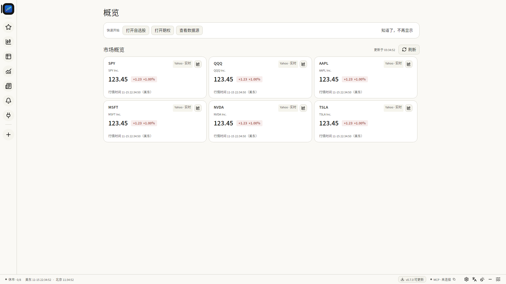
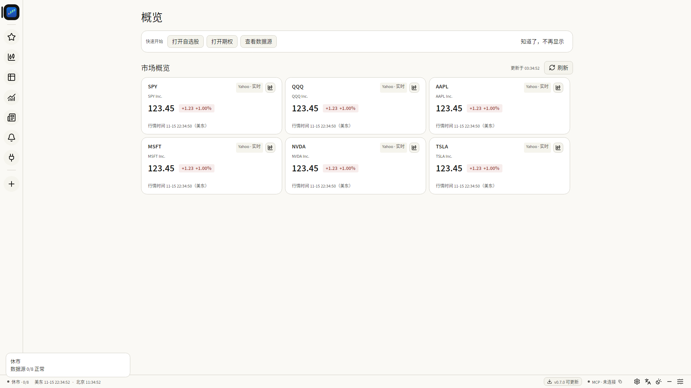
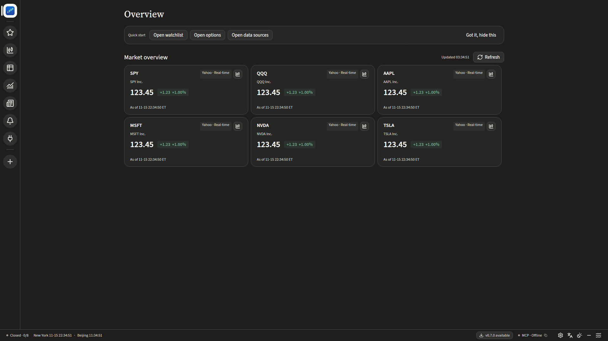
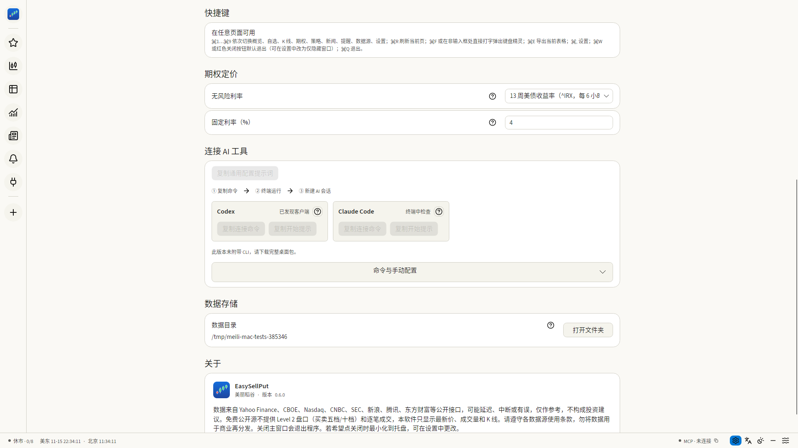

# Compact market and source status

The separate market-session label and source-health label are combined into one entry: `休市 · 0/8` / `Closed · 0/8`. The fraction is the number of healthy data sources over registered sources, not an exchange-open indicator. The dot reflects source health; unknown remains neutral and degraded/down sources use the warning color.

Hover/focus shows the full session, source-health summary and configured network description. Clicking uses the existing accessible `AppHelp` popup, with Escape/focus handling and existing motion. No new navigation, polling, network checks or CLI/MCP operation is introduced. Clock, MCP, updates and footer utilities remain separate.

Both WPF and Avalonia reuse the same `ShellViewModel` presentation properties. Existing hidden-window timer suspension and restoration refresh are preserved. The existing full Shared/Mac/Windows CI suites discover the new shared-state and native UI regressions automatically; no new job or test allowlist is needed.

## Full HD previews

These are actual 1920×1080 Skia renders with test data, not live quotes or screenshots of an OS-native title bar. Images retain original resolution; no upscaling. Dimensions and hashes are in [screenshots.json](screenshots.json).

## Shared vertical alignment and visible About text

Footer typography now uses reusable `StatusText`, `StatusEntry` and `StatusDot` styles. `StatusItemHeight` (24), `StatusLineHeight` (16) and `StatusDotSize` (6) come from the shared token generator. Market, clock, MCP, update text, dots and utility icons use the same vertical centre without compensating offsets. Previously the clock stretched without vertical alignment and the MCP entry used a different height.

Geometry regressions compare the real rendered centres (within 0.75 DIP) and line heights at 980/1920 widths, both languages/themes, including a visible update badge and all footer icons. The component gallery also demonstrates the shared status typography/entry.

The Settings About source/usage description is now an ordinary wrapping text block in its card, not a help tooltip. Both desktop tests verify the full localized text is readable without interaction and wraps at both widths.

